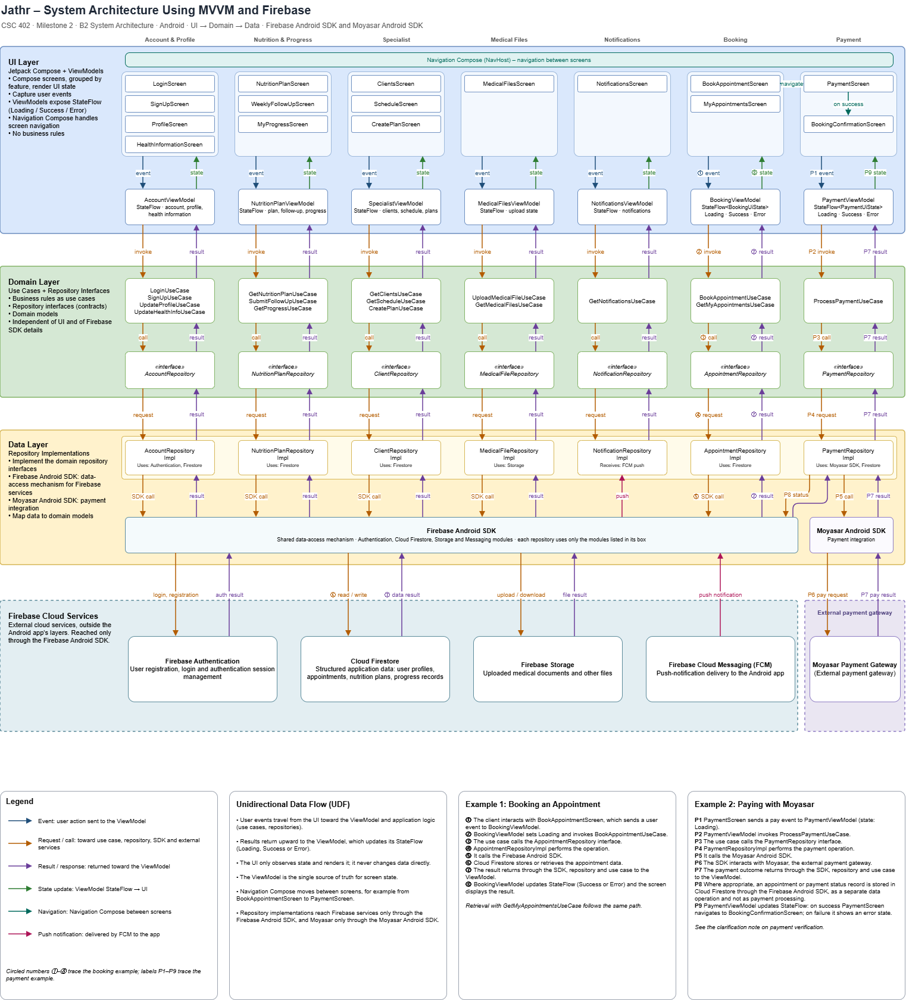

# Jathr — System Architecture Using MVVM and Firebase

**CSC 402 · Milestone 2 · Part B2 · Android (Kotlin, Jetpack Compose)**

## 1. Introduction

Jathr is an Arabic-first (RTL) Android application that brings nutrition specialists and their clients into one place: booking and paying for consultations, uploading medical files, following a personalized nutrition plan, filling in weekly follow-ups, and tracking progress.

We organize the app with **MVVM on top of a Clean Architecture layering** (UI → Domain → Data). The Data layer reaches cloud services directly through the **Firebase Android SDK** (authentication, structured data, file storage and push messaging) and the **Moyasar Android SDK** (card payments). We chose this approach for four reasons:

1. **Separation of concerns.** Screens only render state; business rules live in use cases; Firebase and Moyasar details live in repository implementations. Each part can be changed without breaking the others.
2. **Fits Jetpack Compose.** Compose is declarative: the UI is a function of state. A `ViewModel` exposing `StateFlow` maps directly onto this model.
3. **Testability.** The Domain layer depends only on repository *interfaces*, so use cases and ViewModels can be tested with fake repositories, with no Android framework or network needed.
4. **Team parallelism.** Because layers communicate through contracts (use cases and repository interfaces), team members can build the UI, the domain logic and the data sources at the same time.

The architecture follows the **Unidirectional Data Flow (UDF)** principle: *events flow up, state flows down*.



*Figure 1 — System architecture (MVVM): UI → Domain → Data → Firebase Cloud Services and the external payment gateway.*

---

## 2. Architecture Overview

The system has five tiers. The first three live inside the Android app; the last two are outside it.

| Tier | Where | Role |
|---|---|---|
| UI Layer | Android app | Compose screens, ViewModels, navigation |
| Domain Layer | Android app | Use cases, repository interfaces, domain models |
| Data Layer | Android app | Repository implementations that use the Firebase Android SDK and the Moyasar Android SDK |
| Firebase Cloud Services | Cloud (outside the app) | Authentication, Cloud Firestore, Storage, Cloud Messaging (FCM). Reached only through the Firebase Android SDK |
| External payment gateway | Third party | Moyasar Payment Gateway (card payments). Reached only through the Moyasar Android SDK |

The app is organized by **feature columns**, and each feature has its own screens, ViewModel, use cases and repository:

**Account & Profile · Nutrition & Progress · Specialist · Medical Files · Notifications · Booking · Payment**

---

## 3. Layer Responsibilities and Golden Rules

### 3.1 UI Layer

**Technology:** Jetpack Compose, ViewModel, StateFlow, Navigation Compose.

**Responsibilities**
- Render screens (Compose) grouped by feature.
- Capture user input and send it to the ViewModel as **events**.
- Observe the ViewModel's `StateFlow` and render the current state (Loading / Success / Error).
- Handle navigation between screens through the Navigation Compose `NavHost`.

**Golden rule:** *The UI layer contains no business logic and never accesses Firebase, Moyasar or any data source directly.*

### 3.2 Domain Layer

**Technology:** Pure Kotlin (use cases, repository interfaces, domain models).

**Responsibilities**
- Hold the application's **business rules** as use cases (e.g., booking, payment processing).
- Define **repository interfaces** (contracts) that describe what data the app needs, without saying how it is obtained.
- Define domain models used across the app.

**Golden rule:** *The Domain layer is independent of the UI and of Firebase SDK details.* It does not know about Compose, Firebase or Moyasar.

### 3.3 Data Layer

**Technology:** Repository implementations, Firebase Android SDK, Moyasar Android SDK.

**Responsibilities**
- Implement the repository interfaces from the Domain layer.
- Use the **Firebase Android SDK** as the shared data-access mechanism (Authentication, Cloud Firestore, Storage and Messaging). Each repository uses only the modules it needs.
- Use the **Moyasar Android SDK** for payment integration.
- Map Firebase and Moyasar data into domain models.

**Golden rule:** *The Data layer contains no UI logic and exposes data only through repository interfaces.* Firebase services are reached only through the Firebase Android SDK, and Moyasar only through the Moyasar Android SDK.

**Which repository uses what**

| Repository implementation | Uses |
|---|---|
| `AccountRepositoryImpl` | Firebase Authentication, Cloud Firestore |
| `NutritionPlanRepositoryImpl` | Cloud Firestore |
| `ClientRepositoryImpl` | Cloud Firestore |
| `MedicalFileRepositoryImpl` | Firebase Storage |
| `NotificationRepositoryImpl` | Receives FCM push notifications |
| `AppointmentRepositoryImpl` | Cloud Firestore |
| `PaymentRepositoryImpl` | Moyasar Android SDK, Cloud Firestore |

---

## 4. Layer Components

| Layer | Responsibility | Key classes |
|---|---|---|
| **UI** | Displays screens, collects input, observes state, manages navigation | `LoginScreen`, `SignUpScreen`, `ProfileScreen`, `HealthInformationScreen`, `NutritionPlanScreen`, `WeeklyFollowUpScreen`, `MyProgressScreen`, `ClientsScreen`, `ScheduleScreen`, `CreatePlanScreen`, `MedicalFilesScreen`, `NotificationsScreen`, `BookAppointmentScreen`, `MyAppointmentsScreen`, `PaymentScreen`, `BookingConfirmationScreen`, `NavHost` |
| **UI (state holders)** | Hold `StateFlow<UiState>` per feature, receive events, call use cases | `AccountViewModel`, `NutritionPlanViewModel`, `SpecialistViewModel`, `MedicalFilesViewModel`, `NotificationsViewModel`, `BookingViewModel`, `PaymentViewModel` |
| **Domain (use cases)** | Business rules, one action per use case | `LoginUseCase`, `SignUpUseCase`, `UpdateProfileUseCase`, `UpdateHealthInfoUseCase`, `GetNutritionPlanUseCase`, `SubmitFollowUpUseCase`, `GetProgressUseCase`, `GetClientsUseCase`, `GetScheduleUseCase`, `CreatePlanUseCase`, `UploadMedicalFileUseCase`, `GetMedicalFilesUseCase`, `GetNotificationsUseCase`, `BookAppointmentUseCase`, `GetMyAppointmentsUseCase`, `ProcessPaymentUseCase` |
| **Domain (contracts)** | Repository interfaces | `AccountRepository`, `NutritionPlanRepository`, `ClientRepository`, `MedicalFileRepository`, `NotificationRepository`, `AppointmentRepository`, `PaymentRepository` |
| **Data (repositories)** | Implement the contracts, map data, call the SDKs | `AccountRepositoryImpl`, `NutritionPlanRepositoryImpl`, `ClientRepositoryImpl`, `MedicalFileRepositoryImpl`, `NotificationRepositoryImpl`, `AppointmentRepositoryImpl`, `PaymentRepositoryImpl` |
| **Data (SDKs)** | Shared data-access mechanisms | Firebase Android SDK (Authentication, Cloud Firestore, Storage, Messaging), Moyasar Android SDK |
| **Firebase Cloud Services** | External cloud services, reached only through the Firebase Android SDK | Firebase Authentication, Cloud Firestore, Firebase Storage, Firebase Cloud Messaging (FCM) |
| **External** | Card payments | Moyasar Payment Gateway |

---

## 5. Unidirectional Data Flow (UDF)

In Jathr, data moves in one direction around a loop:

- **Events travel up.** User actions (taps, text input, selections) are sent from the Compose screen to the ViewModel, then to use cases, repositories and the SDKs.
- **Results travel back** along the same chain: from Firebase or Moyasar through the SDK, the repository and the use case to the ViewModel.
- **State flows down.** The ViewModel writes the result into its `StateFlow`. The UI only *observes* this state and re-renders.

Key principles:

1. The UI never changes data directly; it only sends events.
2. The **ViewModel is the single source of truth** for each screen's state.
3. State is exposed as an immutable `UiState` (`Loading`, `Success`, `Error`).
4. Navigation Compose moves between screens in response to state (e.g., after a successful booking, navigate from `BookAppointmentScreen` to `PaymentScreen`).
5. Repository implementations reach Firebase services only through the Firebase Android SDK, and Moyasar only through the Moyasar Android SDK.

### Example: Book Appointment screen

**UiState**

```kotlin
sealed interface BookingUiState {
    data object Loading : BookingUiState
    data class Success(val slots: List<Slot>, val bookingId: String? = null) : BookingUiState
    data class Error(val message: String) : BookingUiState
}
```

**Events (UI → ViewModel)**

```kotlin
sealed interface BookingEvent {
    data object LoadAvailableAppointments : BookingEvent
    data class SelectAppointmentSlot(val slot: Slot) : BookingEvent
    data object ConfirmBooking : BookingEvent
    data object RetryLoading : BookingEvent
}
```

**ViewModel (excerpt)**

```kotlin
@HiltViewModel
class BookingViewModel @Inject constructor(
    private val bookAppointment: BookAppointmentUseCase
) : ViewModel() {

    private val _state = MutableStateFlow<BookingUiState>(BookingUiState.Loading)
    val state: StateFlow<BookingUiState> = _state.asStateFlow()

    fun onEvent(event: BookingEvent) {
        when (event) {
            is BookingEvent.ConfirmBooking -> confirm()
            // other events ...
            else -> Unit
        }
    }

    private fun confirm() = viewModelScope.launch {
        _state.value = BookingUiState.Loading
        bookAppointment(selectedSlot)
            .onSuccess { _state.value = BookingUiState.Success(slots, it.id) }
            .onFailure { _state.value = BookingUiState.Error(it.message ?: "Booking failed") }
    }
}
```

*(Excerpt is illustrative; the final code may differ.)*

---

## 6. Walk-through: Booking an Appointment

The numbers below match the circled numbers (①–⑧) in the architecture diagram.

| Step | Layer | What happens |
|---|---|---|
| **①** | UI | The client selects an available time slot and taps **Confirm** in `BookAppointmentScreen`, which sends an event to `BookingViewModel`. |
| **②** | UI | `BookingViewModel` sets its `StateFlow` to `Loading` and invokes `BookAppointmentUseCase`. |
| **③** | Domain | The use case calls the `AppointmentRepository` interface. |
| **④** | Data | `AppointmentRepositoryImpl` performs the operation. |
| **⑤** | Data | It calls the **Firebase Android SDK**. |
| **⑥** | Firebase | **Cloud Firestore** stores or retrieves the appointment data. |
| **⑦** | Data → Domain → UI | The result returns through the SDK, the repository and the use case to `BookingViewModel`. |
| **⑧** | UI | `BookingViewModel` updates its `StateFlow` (`Success` or `Error`) and the screen displays the result. On success, Navigation Compose navigates to `PaymentScreen`. |

Retrieving appointments with `GetMyAppointmentsUseCase` follows the same path.

---

## 7. Walk-through: Paying with Moyasar (Visa)

The labels below match **P1–P9** in the diagram.

| Step | Layer | What happens |
|---|---|---|
| **P1** | UI | `PaymentScreen` sends a *pay* event to `PaymentViewModel` (state: `Loading`). |
| **P2** | UI → Domain | `PaymentViewModel` invokes `ProcessPaymentUseCase`. |
| **P3** | Domain | The use case calls the `PaymentRepository` interface. |
| **P4** | Data | `PaymentRepositoryImpl` performs the payment operation. |
| **P5** | Data | It calls the **Moyasar Android SDK**. |
| **P6** | SDK → External | The SDK interacts with **Moyasar**, the external payment gateway (mada, Visa and Mastercard are handled by the gateway). |
| **P7** | Data → Domain → UI | The payment outcome returns through the SDK, the repository and the use case to `PaymentViewModel`. |
| **P8** | Data → Firebase | Where appropriate, an appointment or payment status record is stored in **Cloud Firestore** through the Firebase Android SDK. This is a separate data operation, not payment processing. |
| **P9** | UI | `PaymentViewModel` updates its `StateFlow`. On **success**, `PaymentScreen` navigates to `BookingConfirmationScreen`. On **failure**, `PaymentScreen` shows the error state with a retry option. |

---

## 8. Design Decisions Summary

- **Firebase through one SDK.** Authentication, structured data (Cloud Firestore), file storage (Firebase Storage) and push notifications (FCM) are all reached through the Firebase Android SDK, so the app has no REST API clients of its own and no local database.
- **Payments through a dedicated SDK.** Card payments go through the Moyasar Android SDK, and Firebase is used only for the separate record of appointment or payment status.
- **One ViewModel per feature, one use case per action.** This keeps classes small, focused and easy to test.
- **The Domain layer hides the services.** Because the UI and Domain layers only know repository interfaces, the data sources can change without touching screens or business rules.
- **Navigation is state-driven.** Screen transitions (e.g., booking → payment → confirmation) respond to ViewModel state rather than being triggered from data-layer code.
